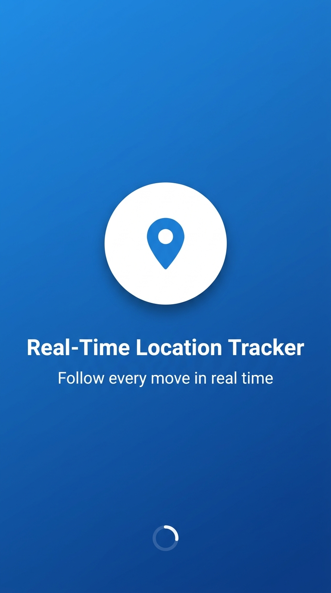
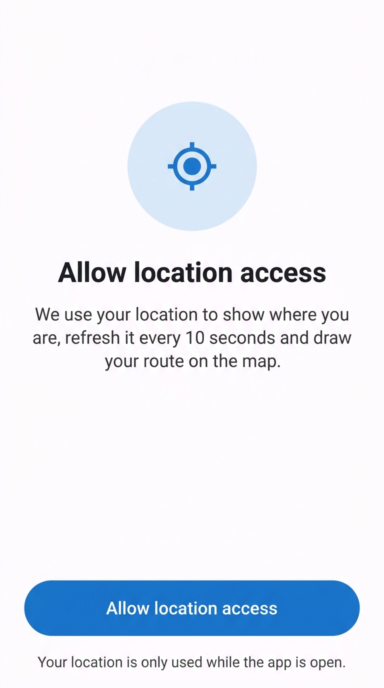
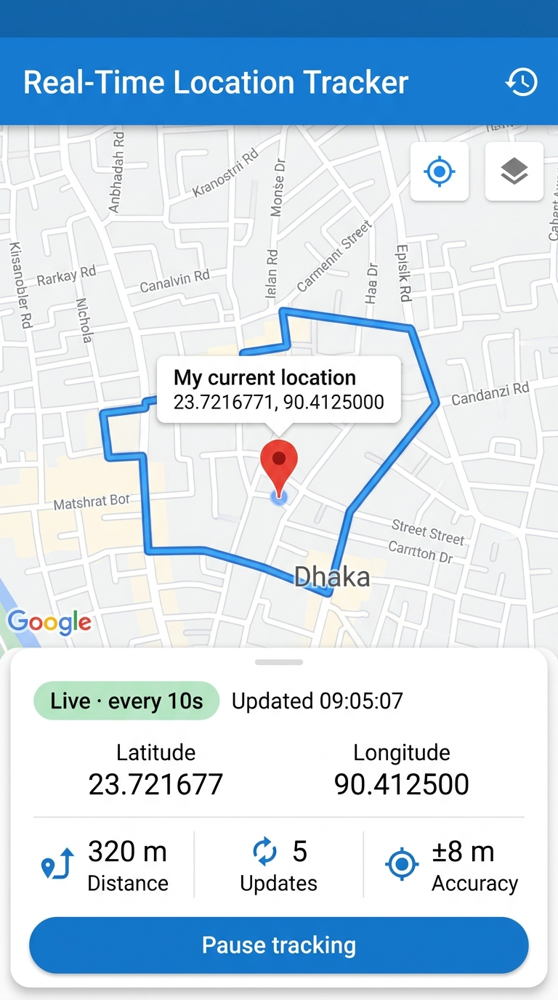
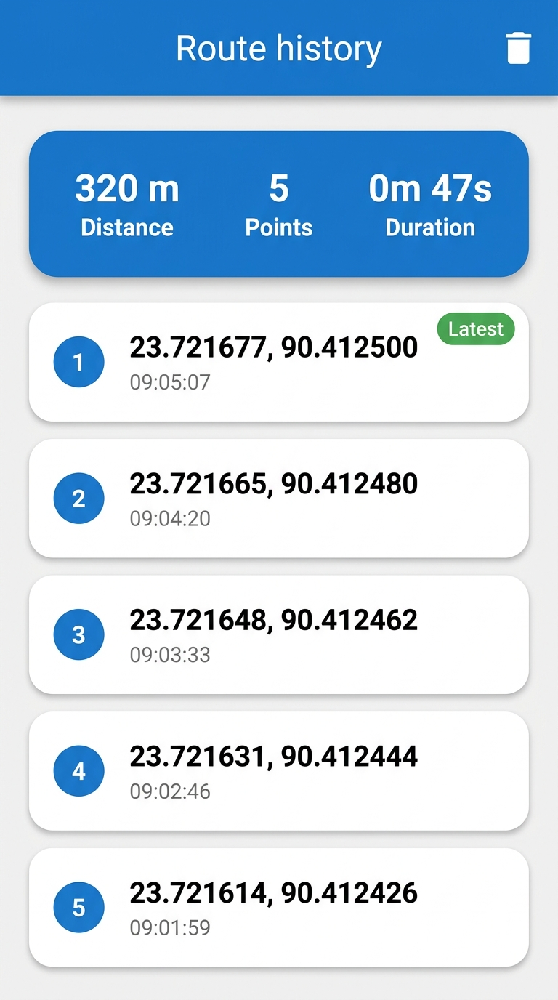
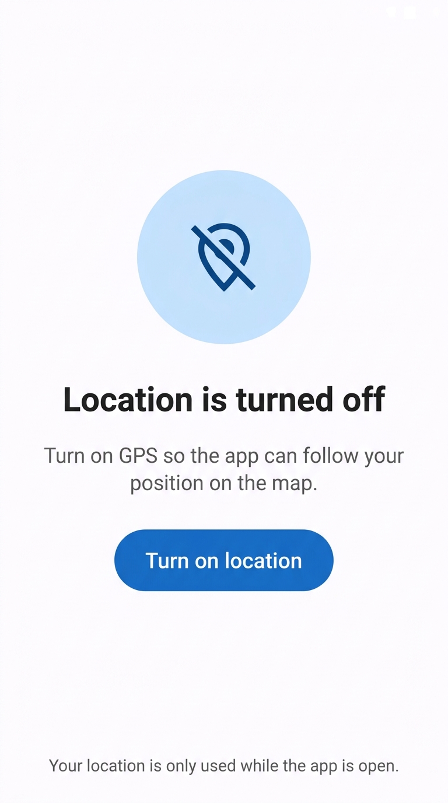

# 📍 Real-Time Location Tracker

[](https://flutter.dev)
[](https://dart.dev)
[](https://developers.google.com/maps)
[](LICENSE)

A production-ready Flutter application built for **Module 18 Assignment (Google Maps & Geolocator)**. The app tracks the user's live GPS coordinates in real-time at 10-second intervals, updates a marker with a customized info window, continuously extends a polyline path on Google Maps, and offers route statistics and history logging.

---

## 📱 App Screenshots

| 1. Splash Screen | 2. Permission Request | 3. Live Tracker & Map |
| :---: | :---: | :---: |
|  |  |  |

| 4. Route History | 5. GPS Disabled State |
| :---: | :---: |
|  |  |

---

## ✨ Features & Assignment Checklist

- [x] **Smooth Camera Animation:** Automatically animates the camera to center on the user's current GPS position upon the first fix and follows future movements.
- [x] **Real-Time Periodic Updates:** Fetches user location every **10 seconds** using the `geolocator` package.
- [x] **Live Marker Updates:** Dynamically shifts the red pin marker to the latest GPS coordinate.
- [x] **Interactive Marker Info Window:** Tapping the marker displays `"My current location"` as the title and precise latitude/longitude as the snippet.
- [x] **Dynamic Polyline Tracking:** Draws and extends a vivid polyline connecting past and current coordinates as the user moves.
- [x] **Live Stats Bottom Panel:** Displays live latitude, longitude, total distance traveled (m / km), update counter, accuracy indicator, and tracking pause/resume button.
- [x] **Route History Screen:** Dedicated log showing track point index, timestamps, exact coordinates, overall distance, and total tracking duration.
- [x] **Permission & GPS Handling:** 
  - Splash screen bootstraps permission checking.
  - Custom UI for when permission is denied or permanently denied (with one-tap navigation to app settings).
  - Dedicated notification screen when device GPS/Location services are disabled.
- [x] **Map Type & Controls:** Satellite / Normal map layer toggle, Follow-Me toggle, zoom in/out controls.

---

## 🏗️ Project Architecture

The project follows a clean, modular MVC/Provider architecture:

```
lib/
├── app.dart                   # Root MaterialApp with theme & routing
├── main.dart                  # App entry point
├── core/
│   ├── constants.dart         # Map & tracking configuration constants
│   ├── formatters.dart        # Distance, time, accuracy & coordinate formatters
│   ├── routes.dart            # Named routes and smooth transitions
│   └── theme.dart             # App color schemes and typography
├── models/
│   └── track_point.dart       # TrackPoint model with timestamp and lat/lng
├── services/
│   └── location_service.dart  # Geolocator wrapper (permissions, service status, GPS stream)
├── controllers/
│   └── tracking_controller.dart # State management (Timer, path, distance, pause/resume)
├── screens/
│   ├── splash_screen.dart     # App launcher & initialization
│   ├── permission_screen.dart # Graceful location permission & GPS enable screen
│   ├── tracker_screen.dart    # Main interactive Google Maps tracking screen
│   └── history_screen.dart    # Detailed route logs and statistics
└── widgets/
    ├── map_action_button.dart # Custom floating map control buttons
    └── stats_panel.dart       # Bottom sheet showing live tracking statistics
```

---

## 🚀 Getting Started

### Prerequisites

- [Flutter SDK](https://docs.flutter.dev/get-started/install) (v3.24.0 or higher recommended)
- Android Studio / VS Code with Flutter extensions
- Android device or emulator with **Google Play Services**
- Google Cloud account with a **Google Maps API Key** ([Maps SDK for Android](https://console.cloud.google.com/google/maps-apis/))

### Installation & Setup

1. **Clone the repository:**
   ```bash
   git clone https://github.com/Rohan2002-33/real_time_location_tracker.git
   cd real_time_location_tracker
   ```

2. **Install dependencies:**
   ```bash
   flutter pub get
   ```

3. **Configure Google Maps API Key:**
   Add your API key inside `android/local.properties` (kept secure and ignored by `.gitignore`):
   ```properties
   MAPS_API_KEY=YOUR_ACTUAL_GOOGLE_MAPS_API_KEY
   ```
   *The build system automatically injects `MAPS_API_KEY` into `AndroidManifest.xml` via `manifestPlaceholders`.*

4. **Run the App:**
   ```bash
   flutter run
   ```

---

## 🧪 Testing & Verification

### Running Unit Tests

```bash
flutter test
```

### Simulating Movement on Android Emulator

1. Launch your Android Emulator.
2. Open the emulator sidebar and click **More (`⋯`)** → **Location**.
3. Under the **Routes** tab, search for a starting location (e.g. Dhaka) and click **Play route**, or set individual points sequentially under **Single points**.
4. Observe the marker moving, camera animating, and the blue polyline growing at 10-second intervals.

---

## 📦 Packages & Dependencies

| Package | Purpose |
| :--- | :--- |
| [`google_maps_flutter`](https://pub.dev/packages/google_maps_flutter) | Interactive Google Maps rendering & polyline / marker manipulation |
| [`geolocator`](https://pub.dev/packages/geolocator) | Real-time GPS coordinate fetching & permission management |
| [`provider`](https://pub.dev/packages/provider) | Reactive state management for tracking state |
| [`intl`](https://pub.dev/packages/intl) | Date and time formatting |

---

## 📄 License

This project is open-source under the [MIT License](LICENSE).